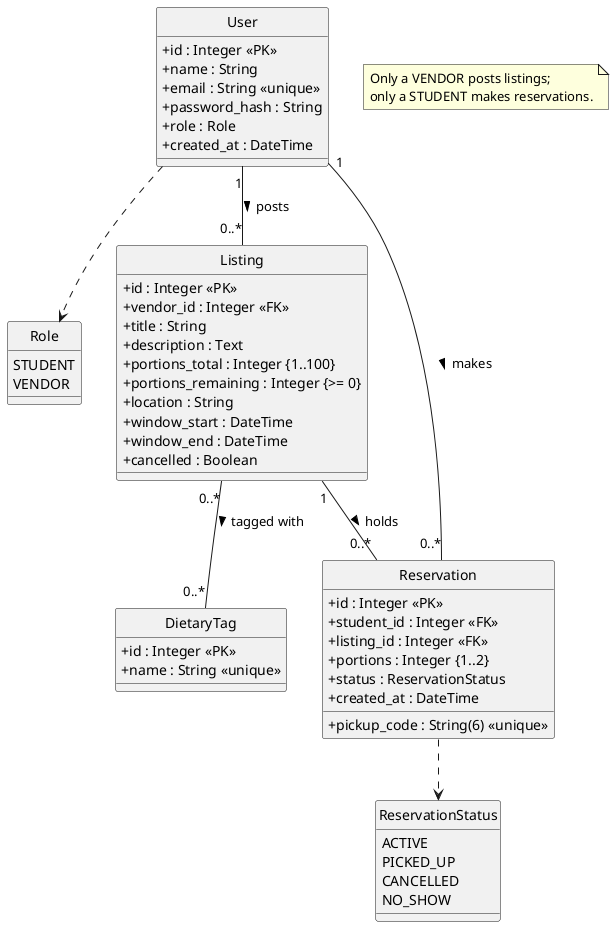
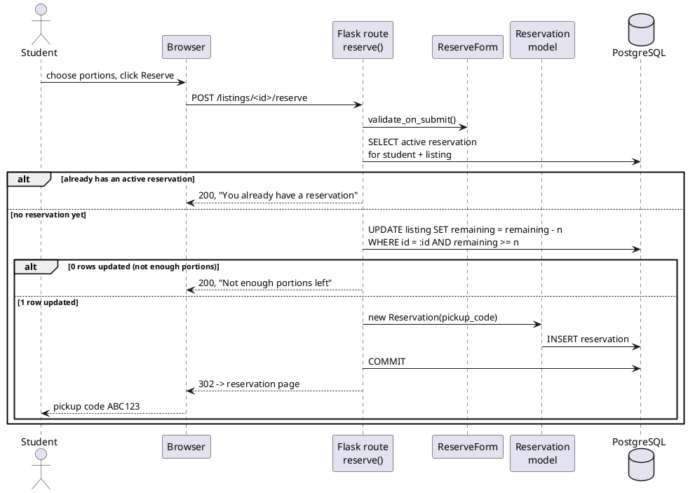

# /uml

Two diagrams, **+5** together: class **+3**, sequence **+2**. Due by the end of Sprint 1, updated in later sprints if the design changes. Take which one from the request; with none, do both.

## Sources

- **Class diagram**: `src/app/models.py` once it exists - read the code, a diagram drawn from memory drifts. Before the code exists, the acceptance criteria in [README.md](../../../README.md#acceptance-criteria) and decisions from `/new-design`.
- **Sequence diagram**: the story's route in `src/app/routes.py` and its criteria.

## Class diagram

`uml/class.wsd` needs at least **User, Vendor or a role, Listing, Reservation and DietaryTag**, their key attributes, and their associations **with multiplicities**. The database tables must be traceable to it. The template ships a stub `User` - replace it.

Pick one way to model the role and say it in a note: a `role` attribute on `User` (simplest), or `Student` and `Vendor` subclasses of `User`. Either satisfies "Vendor or role".



This is a starting shape, not the answer - match it to the actual models. Add `Rating` (US10) only if that story is built.

## Sequence diagram

`uml/sequence-US<n>.wsd` (rename the template - the `#` is a placeholder) shows **one story's full flow from the browser through the Flask route, any service or model classes, and PostgreSQL**, with **at least one alternative path**. US4 or US7 are the suggested choices.



Every message is something the code actually does, in the order it does it. The conditional `UPDATE` is what makes US4.4 visible in the diagram.

## Render and commit

```
plantuml uml/class.wsd uml/sequence-US4.wsd
```

Or the PlantUML extension in VS Code. Commit the rendered PNGs beside the sources so the grader does not have to render them.

## Keep them true

A diagram that disagrees with the code is worth less than one that is plainly incomplete. Re-run after any `/new-model`, and when the story's route changes.
